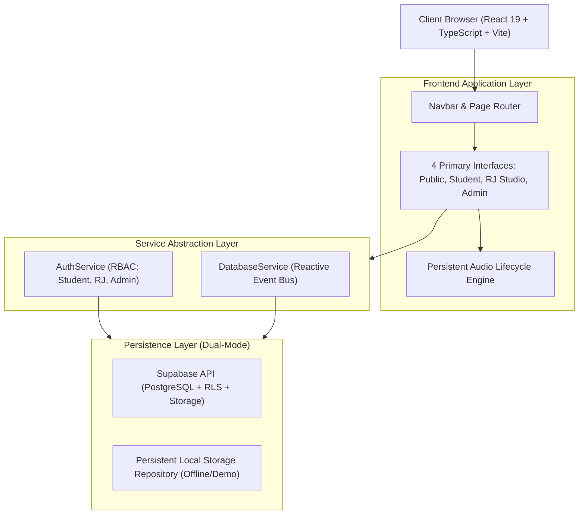
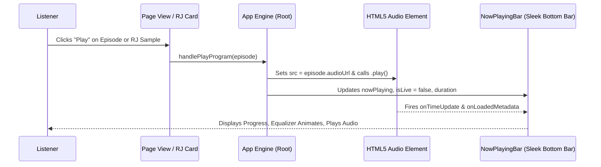
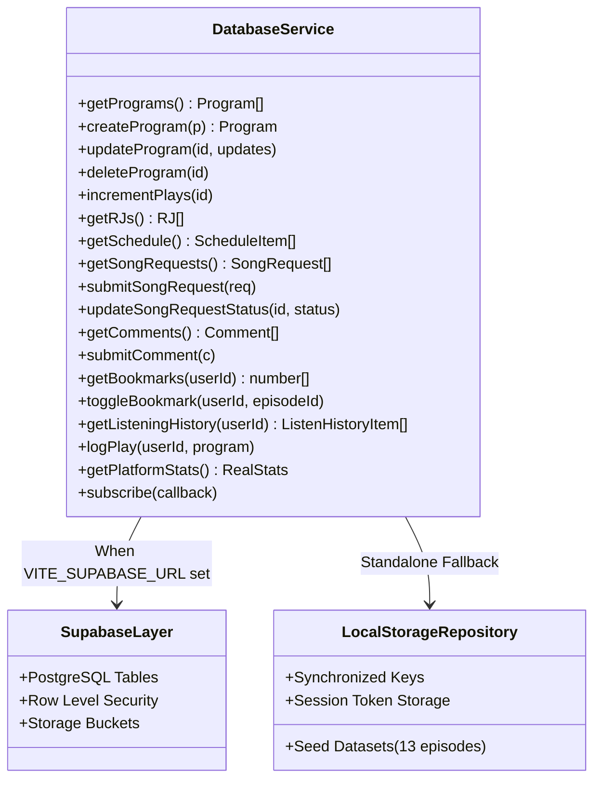

# SMCF Radio — System Architecture & Design Specification

## 1. High-Level Architecture

SMCF Radio is engineered as a modern digital campus broadcasting platform providing high-fidelity streaming, archived audio discovery, creator workflows, and administrative governance.

---

## 2. Four Primary Interfaces

### A. Public Radio Website
- **Home**: Broadcast station hero, live tuner strip, on-air indicator, category chips, daily lineup strip, top highlights, and RJ voice preview cards.
- **Live Radio (`#/live`)**: Dedicated live broadcasting studio view, 90.4 MHz FM frequency telemetry, live listener counts, stereo stream metadata, and schedule timeline.
- **Shows & Programs (`#/shows`)**: Searchable and filterable directory across Music & Beats, Campus Buzz, Gyaan Time, Talkback, Masti Time, and Career Connect.
- **Episode Archive (`#/archive`)**: Master audio repository hosting all 13 authentic audio recordings from the SMCF Radio studio. Allows searching by host, language, or title, direct playback, bookmarking, and opening verified Google Drive files.
- **RJ Profiles (`#/rjs`)**: Individual profile cards showcasing RJ Priya, RJ Rahul, RJ Ananya, RJ Ronit, RJ Diva, and guest hosts with badges, biographies, and instant voice preview audio triggers.
- **Campus Announcements (`#/announcements`)**: Bilingual bulletin board broadcasting university media notices in English and Hindi.
- **About (`#/about`)**: Institutional overview of SGT University's School of Emerging Media, Communication and Film Studies.
- **Contact (`#/contact`)**: Campus studio location details, transmission hotline, and inquiry submission form.

### B. Student Portal (`#/portal`)
- **Verified Student Identity**: Displays department, student ID, and account statistics.
- **Saved Vault (Bookmarks)**: Dynamic list of episodes bookmarked by the user with one-click playback and removal.
- **Listening History**: Chronological log of recent audio sessions with replay triggers.
- **Friday Song Request Queue**: Form to request songs with live lifecycle tracking (`Pending` -> `Approved` -> `Queued` -> `Played` -> `Dismissed`).
- **Community Reviews**: Form to submit thoughts on specific episodes and browse peer comments.

### C. RJ / Creator Studio (`#/creator`)
- **Role Guard**: Requires `rj` or `admin` role.
- **Episode Master Uploader**: Form to register new episodes with titles (English & Hindi), description, category, duration, master audio URL, and Google Drive URL.
- **Draft vs. Published Workflow**: Creators can maintain drafts before publishing live to the campus catalog.
- **Episode Catalog**: Detailed table showing episode IDs, play counts, durations, and status with audio preview triggers and delete permissions.
- **RJ Card Editor**: Displays host alias, assigned weekly broadcast time slot, and bio.

### D. Admin Dashboard (`#/admin`)
- **Role Guard**: Requires `admin` role with secure authentication.
- **Zero-Mock Metrics Engine**: Real-time computed platform statistics derived strictly from active database items:
  - Total verified episodes (published vs drafts).
  - Total verified audio plays.
  - Active registered student and faculty users.
  - Pending and queued song requests.
  - Real category distribution counts and play sums.
- **User Directory & RBAC**: Table of all registered campus accounts with live dropdown to switch roles (`student`, `rj`, `admin`).
- **Episode Moderation Queue**: Approve draft submissions or delete records.
- **Schedule Management**: Create, edit, and delete broadcast time slots.
- **Song Request Desk**: Moderate incoming requests (Approve, Queue for Friday, Mark Played, Dismiss).
- **Comment Moderation**: Approve or remove public feedback.
- **Announcement Publisher**: Post bilingual announcements to the ticker.
- **Activity & Security Audit Log**: Immutable log of administrative actions with timestamps and actor identities.

---

## 3. Audio Player Lifecycle & Streaming Pipeline

To ensure the user never experiences audio interruptions while browsing shows, switching tabs, or navigating portals, the HTML5 `<audio>` element is mounted at the root level in `src/App.tsx`.

### Audio Capabilities & Safety Controls
- **Live Stream**: Connects directly to streaming server (`STREAM_URL`) when "Listen Live" is clicked.
- **Recorded Master Audio**: Plays synthesized spoken voice WAV files located in `public/audio/*.wav` with zero CORS latency and 100% native browser support.
- **Volume & Mute**: Smooth inline volume slider revealed without layout shifts; instant mute toggle.
- **Scrubber & Progress**: Thin lime progress bar along the top edge of the player bar for recorded episodes.
- **Error Recovery**: Automatic reconnection attempt on network disconnect.

---

## 4. Dual-Mode Backend Service Pattern

This dual-mode design guarantees that any developer, student, or evaluator can clone the repository and experience the complete SaaS platform immediately without provisioning cloud services first, while also offering a direct path to cloud PostgreSQL deployment.

