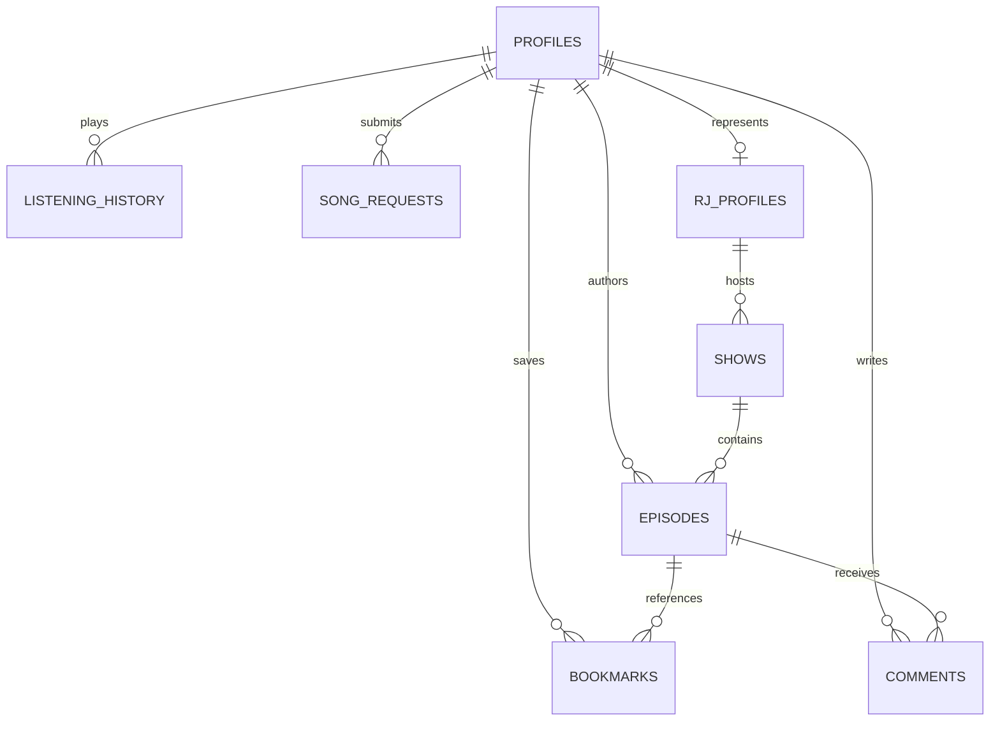

# SMCF Radio — Database Schema & Data Dictionary

## 1. Entity-Relationship Overview

---

## 2. Table Definitions

### 1. `profiles`
Stores registered university accounts (students, RJs, faculty, station administrators).
- `id` (UUID, PK): Unique identifier.
- `email` (TEXT, UNIQUE, NOT NULL): Campus or personal email.
- `name` (TEXT, NOT NULL): Full name.
- `department` (TEXT, NOT NULL): Academic department (e.g., Computer Science, Mass Comm, Film Studies).
- `student_id` (TEXT): University roll/registration number.
- `role` (user_role, NOT NULL): Enum (`student`, `rj`, `admin`).
- `avatar_url` (TEXT): Optional profile image URL.
- `bio` (TEXT): Student or staff biography.
- `created_at` (TIMESTAMPTZ, NOT NULL): Registration timestamp.
- `updated_at` (TIMESTAMPTZ, NOT NULL): Last profile update.

### 2. `rj_profiles`
Dedicated broadcaster metadata for student Radio Jockeys.
- `id` (UUID, PK): Unique identifier.
- `user_id` (UUID, FK -> profiles.id): Associated user account.
- `name` (TEXT, NOT NULL): Full real name.
- `alias` (TEXT, NOT NULL): On-air handle (e.g., RJ Priya, RJ Rahul).
- `department` (TEXT, NOT NULL): Academic department.
- `bio` (TEXT, NOT NULL): On-air show biography.
- `color` (TEXT, NOT NULL): Brand accent color hex code.
- `initials` (TEXT, NOT NULL): 2-character avatar initials.
- `badge` (TEXT): Station badge (e.g., "Friday Broadcaster").
- `audio_url` (TEXT): Spoken voice introduction audio link.
- `drive_url` (TEXT): Backup Google Drive file link.
- `show_time` (TEXT): Scheduled broadcast slot.
- `is_active` (BOOLEAN, NOT NULL): Active broadcaster status.

### 3. `shows`
Flagship show titles and series produced by SMCF.
- `id` (UUID, PK): Unique identifier.
- `title` (TEXT, NOT NULL): English show title.
- `title_hi` (TEXT): Hindi show title.
- `slug` (TEXT, UNIQUE, NOT NULL): URL-safe identifier.
- `description` (TEXT): Overview and themes.
- `category` (TEXT, NOT NULL): Category slug.
- `language` (TEXT, NOT NULL): Language code (HI, EN, Bilingual).
- `rj_id` (UUID, FK -> rj_profiles.id): Primary host.
- `rj_name` (TEXT, NOT NULL): Host display name.
- `cover_image` (TEXT): Show banner artwork.
- `is_active` (BOOLEAN, NOT NULL): Active show status.

### 4. `episodes`
Audio master recordings, podcasts, and interviews.
- `id` (SERIAL, PK): Integer episode ID.
- `show_id` (UUID, FK -> shows.id): Associated show.
- `title` (TEXT, NOT NULL): Episode title in English.
- `title_hi` (TEXT): Episode title in Hindi.
- `description` (TEXT, NOT NULL): Episode notes and guest credits.
- `category` (TEXT, NOT NULL): Category slug.
- `language` (TEXT, NOT NULL): Broadcast language.
- `rj_name` (TEXT, NOT NULL): Lead host / RJ.
- `duration` (TEXT, NOT NULL): Formatted runtime (e.g., "24 min").
- `plays` (INTEGER, NOT NULL): Real verified play count.
- `audio_url` (TEXT, NOT NULL): Master audio file stream URL.
- `drive_url` (TEXT): Google Drive reference link.
- `is_featured` (BOOLEAN, NOT NULL): Featured on home highlights.
- `status` (episode_status, NOT NULL): Enum (`draft`, `pending`, `published`, `archived`).
- `submitted_by` (UUID, FK -> profiles.id): Author account.
- `published_at` (TIMESTAMPTZ): Live broadcast date.
- `created_at` (TIMESTAMPTZ, NOT NULL): Submission date.

### 5. `schedules`
Weekly programming schedule slots for campus broadcasts.
- `id` (SERIAL, PK): Slot identifier.
- `time_slot` (TEXT, NOT NULL): E.g., "11:00 AM — 12:00 PM".
- `title` (TEXT, NOT NULL): Program slot title.
- `rj_name` (TEXT, NOT NULL): Host name.
- `day_of_week` (TEXT, NOT NULL): Broadcast day (e.g., "Friday").
- `status` (schedule_status, NOT NULL): Enum (`done`, `live`, `next`, `scheduled`).
- `is_active` (BOOLEAN, NOT NULL): Slot status.

### 6. `announcements`
Official station notifications and audition calls.
- `id` (SERIAL, PK): Notice identifier.
- `en` (TEXT, NOT NULL): Bulletin in English.
- `hi` (TEXT, NOT NULL): Bulletin in Hindi.
- `priority` (TEXT, NOT NULL): 'normal' or 'urgent'.
- `is_active` (BOOLEAN, NOT NULL): Active notice status.
- `created_at` (TIMESTAMPTZ, NOT NULL): Creation date.

### 7. `song_requests`
Friday live broadcast music requests submitted by students.
- `id` (SERIAL, PK): Request identifier.
- `user_id` (UUID, FK -> profiles.id): Submitting student.
- `song_title` (TEXT, NOT NULL): Track name.
- `artist` (TEXT, NOT NULL): Performer / Band.
- `dedicated_to` (TEXT): Optional student dedication shoutout.
- `requested_by` (TEXT, NOT NULL): Requester name & department.
- `status` (request_status, NOT NULL): Enum (`pending`, `approved`, `queued`, `played`, `dismissed`).
- `created_at` (TIMESTAMPTZ, NOT NULL): Submission date.

### 8. `comments`
Episode feedback, critiques, and listener reviews.
- `id` (SERIAL, PK): Comment identifier.
- `user_id` (UUID, FK -> profiles.id): Author.
- `program_id` (INTEGER, FK -> episodes.id): Target episode.
- `program_title` (TEXT, NOT NULL): Episode name.
- `author_name` (TEXT, NOT NULL): Display author label.
- `content` (TEXT, NOT NULL): Review text.
- `status` (comment_status, NOT NULL): Enum (`pending`, `approved`, `removed`).
- `created_at` (TIMESTAMPTZ, NOT NULL): Post timestamp.

### 9. `bookmarks`
User saved episode vault.
- `id` (UUID, PK): Bookmark record identifier.
- `user_id` (UUID, FK -> profiles.id): Student user.
- `episode_id` (INTEGER, FK -> episodes.id): Bookmarked episode.
- `created_at` (TIMESTAMPTZ, NOT NULL): Save timestamp.

### 10. `listening_history`
Chronological audio listening log for student portal.
- `id` (UUID, PK): History entry identifier.
- `user_id` (UUID, FK -> profiles.id): Listener user.
- `episode_id` (INTEGER, FK -> episodes.id): Played episode.
- `episode_title` (TEXT, NOT NULL): Title of show played.
- `rj_name` (TEXT, NOT NULL): Broadcaster name.
- `played_at` (TIMESTAMPTZ, NOT NULL): Play timestamp.

### 11. `activity_logs`
Security and administrative audit trail.
- `id` (UUID, PK): Log entry identifier.
- `user_id` (UUID, FK -> profiles.id): Actor account.
- `user_name` (TEXT, NOT NULL): Actor name.
- `action` (TEXT, NOT NULL): Administrative action (e.g., 'Episode Approved').
- `details` (TEXT): Descriptive context.
- `created_at` (TIMESTAMPTZ, NOT NULL): Execution timestamp.

---

## 3. Row Level Security (RLS) Policies

All tables in the Supabase PostgreSQL database have Row Level Security enabled:

1. **Public Read Access**: Published episodes, active RJ profiles, public shows, schedules, and active announcements can be read by any anonymous client (`auth.role() = 'anon'` or `'authenticated'`).
2. **User Private Isolation**: Records in `bookmarks` and `listening_history` can only be selected, inserted, updated, or deleted by the owning user (`auth.uid() = user_id`).
3. **Creator Scoping**: Users with `role = 'rj'` or `role = 'admin'` can insert and edit their own episode records in `episodes`.
4. **Administrative Master Privileges**: Accounts with `role = 'admin'` have full read/write/delete access across `episodes`, `song_requests`, `comments`, `schedules`, `announcements`, and `activity_logs`.

