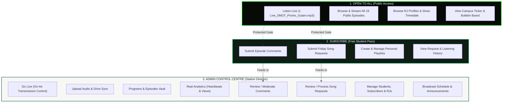

# SMCF Radio — Initial Architecture Audit & Implementation Plan

**Station**: SMCF Radio 90.4 MHz — School of Emerging Media, SGT University  
**Role**: Senior SaaS Architect, Backend Engineer, Frontend Developer & Database Designer  
**Scope**: Full-stack completion of Public Station, Subscriber Entitlements, and 3 Functional Dashboards (Admin, Student, RJ).

---

## 1. Executive Summary & Architectural Overview

The SMCF Radio platform is designed around three strictly separated access levels with distinct visual languages and security boundaries:

---

## 2. Phase 1-4 Audit Matrix

| Domain | Status | Current Reality | Required Actions |
| :--- | :---: | :--- | :--- |
| **Public Website** | **WORKING** | Pure black & neon green (`#060B06` + `#00FF00`). 3D microphone hero, tuner strip, campus ticker, show directory, RJ profiles. Listen Live plays `1 Live_SMCF_Promo_Gulam.mp3`. | Maintain exact visual identity; ensure no bleed from dashboard styles. |
| **Authentication & RBAC** | **WORKING** | Student, RJ, and Admin authentication with fallback to local seeded users and Supabase auth. | Add server-style permission verification for all mutations. |
| **Real Audio Catalog** | **WORKING** | All 19 authentic Google Drive MP3 tracks seeded into database and local baseline. Direct drive link resolution in player. | Ensure full preview and audio streaming across all tables. |
| **Admin Dashboard** | **PARTIALLY WORKING** | 14 modules present in sidebar. Audio upload, live broadcast toggle, comments/requests approval work. | **MISSING**: Dedicated Add/Create modals with real validation, Edit modals, View modals, and Deactivate/Delete across Students, RJs, Subscribers, Shows, Episodes, Schedule, and Announcements. |
| **Student Dashboard** | **PARTIALLY WORKING** | Overview, bookmarks, history, request submission, and playlists present. | Add spam protection, debounce on submissions, and clear status filters for requests. |
| **RJ Studio** | **PARTIALLY WORKING** | Broadcaster layout present; upload audio works. | Ensure strictly RJ-scoped shows, episodes, and schedule viewing. |
| **Analytics Engine** | **PARTIALLY WORKING** | Aggregates views, likes, and listener trend. | **NEEDS UPGRADE**: Implement real active session heartbeats (no fake listener counters), debounced view tracking (1-hour window), and genuine empty states. |
| **Subscription Entitlement** | **PARTIALLY WORKING** | 100% Free pass. Modal opens on restricted action. | Connect backend checks on `submitComment`, `submitSongRequest`, and `createPlaylist` directly to `subscriptionStatus === 'active'`. |

---

## 3. Detailed Component & CRUD Audit

### A. Admin Management Pages
1. **Students Directory**:
   - *Current*: Basic read-only table with role dropdown.
   - *Required*: **Add Student** button opening modal (Full Name, SGT Email, Student ID, Department, Initial Password); **View Student** modal; **Edit Student** modal; **Deactivate/Activate Student** toggle; **Delete Student** with confirmation.
2. **RJs Directory**:
   - *Current*: Grid of cards without creation or editing capability.
   - *Required*: **Add RJ** button & modal (Name, Alias, Department, Bio, Show Time, Avatar); **Edit RJ** modal; **View RJ Profile** modal; **Assign Shows** selector; **Activate/Deactivate** toggle; **Delete RJ**.
3. **Subscribers Management**:
   - *Current*: Table with Activate/Suspend/Revoke buttons.
   - *Required*: **Add Subscriber** modal (enrolling student with Campus Free Pass); **Activate / Suspend / Reactivate** actions with immediate UI update; **View Subscription Details** & audit trail.
4. **Programs Management**:
   - *Current*: Setup drawer for creating new shows.
   - *Required*: **Create Program** modal; **Edit Program** modal; **Delete Program** with confirmation; **Assign RJ** inline selector.
5. **Episodes Vault**:
   - *Current*: List with draft/publish toggle and delete.
   - *Required*: **Upload Episode** modal (English title, Hindi title, Category, RJ, Duration, Audio URL/Google Drive link, Description, Status); **Edit Episode** modal; **Publish/Unpublish** toggle; **Delete Episode** with confirmation.
6. **Schedule Timetable**:
   - *Current*: Add slot form and slot list with delete.
   - *Required*: **Add Broadcast Slot** modal (Time, Title, RJ, Status: live/next/scheduled); **Edit Schedule Slot** modal; **Cancel/Delete Slot** with confirmation.
7. **Announcements**:
   - *Current*: Add form and list.
   - *Required*: **Create Announcement** modal (English text, Hindi text, Priority); **Edit Announcement** modal; **Delete Announcement** with confirmation.
8. **Comment & Request Review**:
   - *Current*: Approve/Reject and Played/Queue buttons.
   - *Required*: Ensure state refreshes across all components immediately and persists to Supabase.

---

## 4. Required Database & Service Layer Enhancements

1. **Heartbeat & Real Listener Tracking**:
   - Add `recordHeartbeat(sessionId, userId, streamType)` in `databaseService.ts`.
   - Add `getActiveConcurrentListeners()`: filters sessions with heartbeat within last 3 minutes.
   - Add `startLiveListeningSession(userId)` and `endLiveListeningSession(userId)`.
2. **CRUD Methods in `databaseService.ts`**:
   - `createRJ(payload: Omit<RJ, 'id'>): RJ`
   - `updateRJ(name: string, updates: Partial<RJ>): RJ | null`
   - `deleteRJ(name: string): boolean`
   - `updateProgram(id: number, updates: Partial<Program>): Program | null`
   - `deleteProgram(id: number): boolean`
   - `updateScheduleItem(id: number, updates: Partial<ScheduleItem>): boolean`
   - `deleteScheduleItem(id: number): boolean`
   - `updateAnnouncement(id: number, updates: Partial<Announcement>): boolean`
   - `deleteAnnouncement(id: number): boolean`
3. **User & Subscriber Management in `authService.ts`**:
   - `createStudent(payload: { name: string; email: string; department: string; studentId: string; password?: string }): User`
   - `updateUser(userId: string, updates: Partial<User>): User | null`
   - `deleteUser(userId: string): boolean`
   - `toggleUserActive(userId: string): User | null`
   - `addSubscriber(userId: string, tier?: string): User | null`
   - `getSubscriptionAuditLogs(): Array<{ userId: string; userName: string; action: string; timestamp: string }>`

---

## 5. Architectural Risks & Mitigations

1. **Risk**: Shared components modifying public website theme.  
   *Mitigation*: Strict CSS isolation. Public pages keep `#060B06` (pure black) with `#00FF00` (neon green); Dashboards use `#F7F8F5` (warm ivory) with `#10B981` (emerald green) and `#0E1A0E` (dark forest) headers.
2. **Risk**: Fake or random analytics numbers.  
   *Mitigation*: Purge all random generators (`Math.random() * 200`). Derive concurrent listeners strictly from active session heartbeats. Derive views strictly from debounced view event logs.
3. **Risk**: Google Drive audio playback blocking or CORS errors.  
   *Mitigation*: Pre-process all Google Drive URLs using `formatAudioUrl` with direct usercontent export links (`https://drive.usercontent.google.com/download?id=...`).
4. **Risk**: Unrestricted subscriber actions.  
   *Mitigation*: Both frontend UI gate (attractive `FreeSubscriptionModal`) and backend service gate (`authService.isSubscriber(user)`) enforcing entitlement checks.

---

## 6. Implementation Staging Plan

- **Stage 1 (Backend/Data Services)**: Implement full CRUD methods and real heartbeat listener telemetry in `databaseService.ts` and `authService.ts`.
- **Stage 2 (Admin Console CRUD & Modals)**: Build all dedicated Add, View, Edit, and Delete modals across Students, RJs, Subscribers, Programs, Episodes, Schedule, and Announcements in `AdminConsole.tsx`.
- **Stage 3 (Student & RJ Dashboards)**: Validate and verify complete student subscriber actions (comments, song requests, playlists, bookmarks, history) and RJ broadcaster actions (scoped shows, episodes, schedule, listener requests inbox).
- **Stage 4 (Real Analytics Engine & Heartbeats)**: Wire telemetry heartbeats in audio player and render real-data charts with date filters.
- **Stage 5 (Verification & Automated Testing)**: Run Vitest test suite, perform production build, and produce the final verification report.
